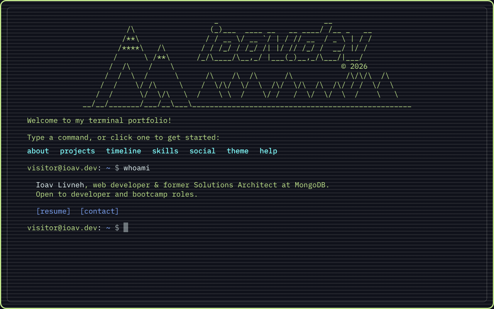

# ioav.dev — Terminal Portfolio

An interactive, terminal-style portfolio for Ioav Livneh, built with React. Instead of scrolling through a page, visitors explore it like a command line: type (or click) commands to learn about my background, projects and skills.

**Live site:** [ioav.dev](https://www.ioav.dev)



## Features

**Terminal experience**
- Commands for everything on the site: `about`, `projects`, `timeline`, `skills`, `social`, `theme`, `sound`, `history`, `help` and `clear`
- Retro sound effects when hovering and clicking commands and links, synthesized in the browser (turn them off with `sound`)
- Tab autocompletion, ↑ / ↓ command history, and a movable cursor that lines up with the text at every screen size
- Responses type out character by character, with a band of shuffling symbols that "decodes" into the text
- An interactive timeline that asks whether to keep going (`[Y/n]`), from my career back to the origin of life

**Click or type**
- Every highlighted command can be clicked or tapped to run it, including the welcome menu, the help list, theme names and the timeline's Y/n prompt
- Fully usable with a keyboard: Shift+Tab out of the prompt, Tab between commands, Enter to run one

**Look and feel**
- Five color themes, each with a preview swatch in the `theme` command
- CRT-style scanlines, a retro pixel-art mouse cursor and a soft glow that follows the mouse
- IBM Plex Mono throughout, sized to stay readable from phones to large monitors

**Easter eggs**
- A handful of familiar Unix commands (`ls`, `cd`, `sudo`, `whoami`, …) answer back
- A classic cheat code unlocks a secret theme. `help` hints at it.

**Built to work everywhere**
- Responsive layout that fills exactly one screen on load, with phone-specific spacing, larger tap targets and touch-friendly behavior (no keyboard popping up on its own)
- Respects the reduced-motion setting: no typing animation, confetti or moving effects for visitors who turn motion off

## Tech stack

| | |
|---|---|
| Framework | [React 18](https://react.dev) (Create React App / `react-scripts`) |
| Styling | Plain CSS with custom properties for theming |
| Font | [IBM Plex Mono](https://fontsource.org/fonts/ibm-plex-mono), self-hosted via Fontsource |
| Libraries | [html-react-parser](https://github.com/remarkablemark/html-react-parser) for command output, [canvas-confetti](https://github.com/catdad/canvas-confetti) |
| Hosting | [Vercel](https://vercel.com), with Vercel Analytics |

## Running it locally

You'll need [Node.js](https://nodejs.org) 18 or newer.

```bash
git clone https://github.com/ioav-livneh/ioav.dev.git
cd ioav.dev
npm install
npm start
```

The site opens at [http://localhost:3000](http://localhost:3000) and reloads as you edit.

To create an optimized production build in `build/`:

```bash
npm run build
```

## Project structure

```
src/
├── commands.js                  # All command output (about, projects, skills, timeline, …) and hidden commands
├── App.js                       # App shell, cheat-code detection and the mouse glow
├── App.css                      # Theme variables, cursors and shared styles
└── components/
    ├── Terminal/Terminal.js     # The terminal: running commands, themes, history, autocomplete
    └── NewLines/NewLines.js     # Renders command output and the typing animation
```

To change what a command says, edit its entry in `src/commands.js`. To add a new command, add its output there and a matching `case` in `handleSubmit` in `Terminal.js`.

## Credits

The idea for this project came from [Forrest Knight's website](https://fkcodes.com/), with inspiration from [Sat Naing's terminal portfolio](https://terminal.satnaing.dev/).
